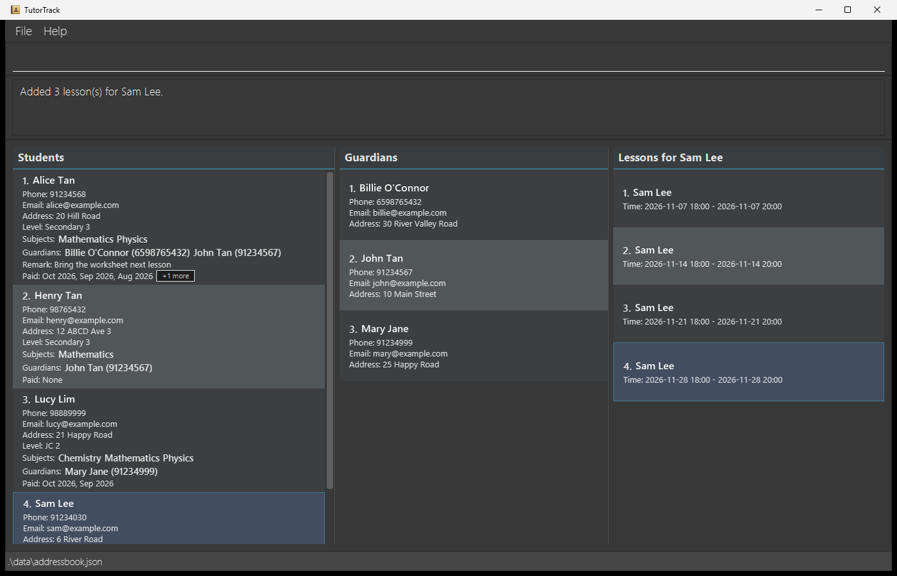
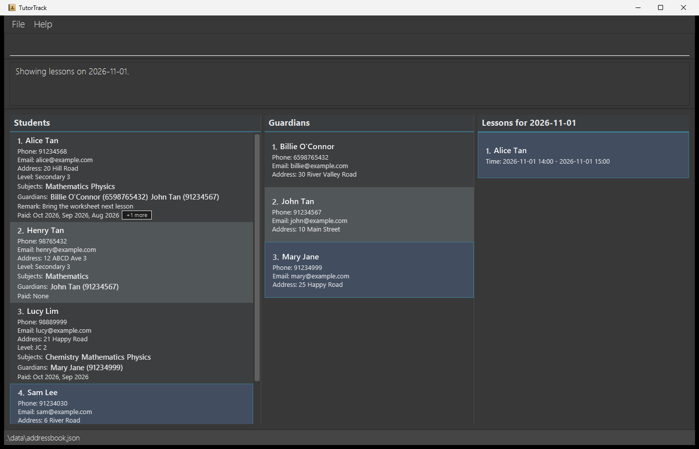
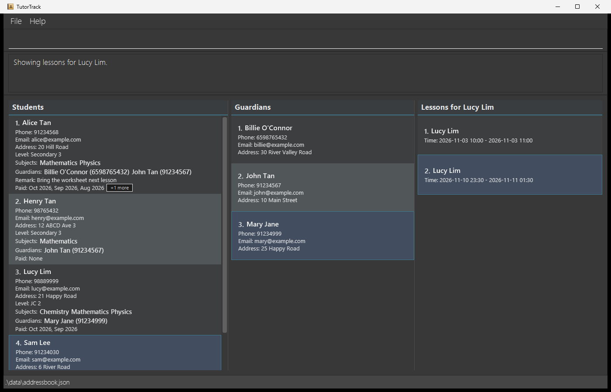
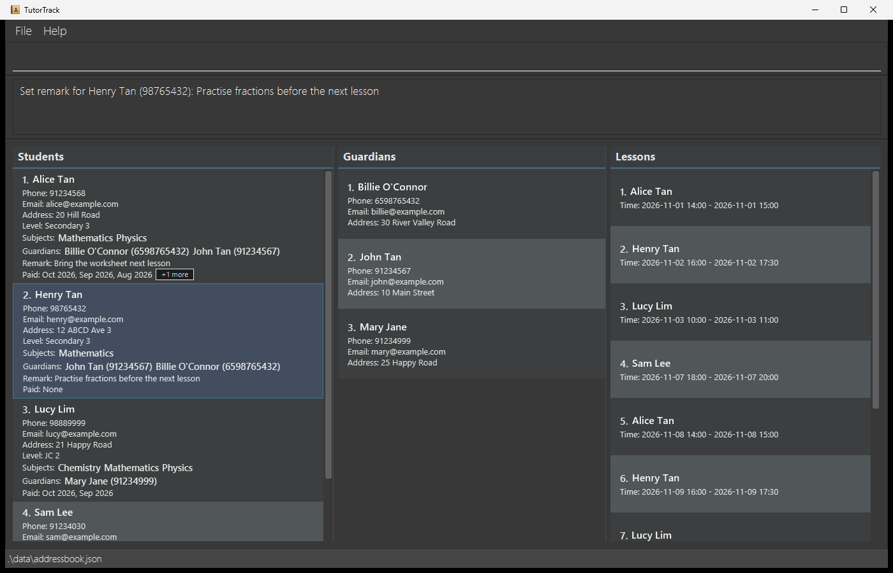
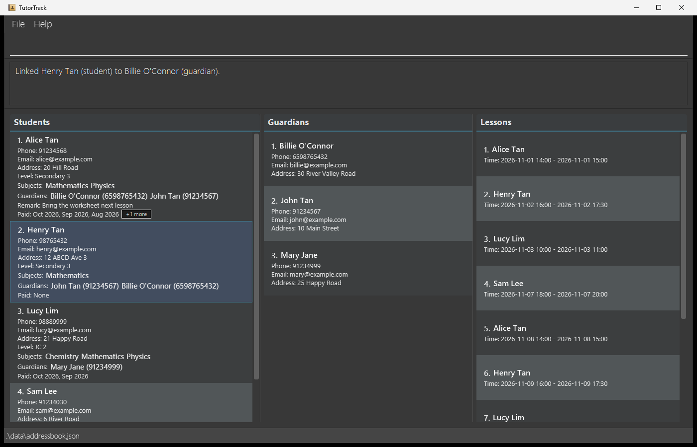
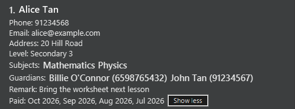
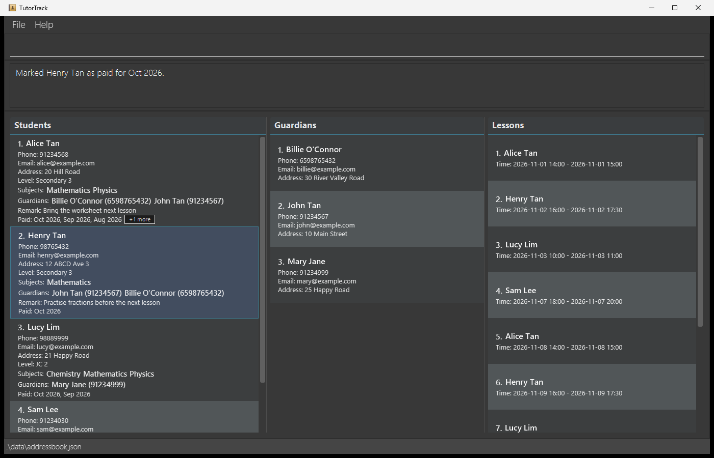
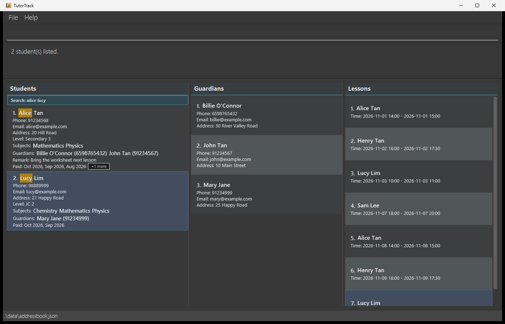
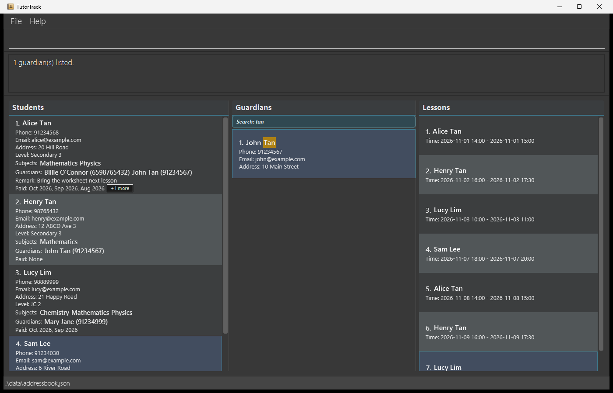
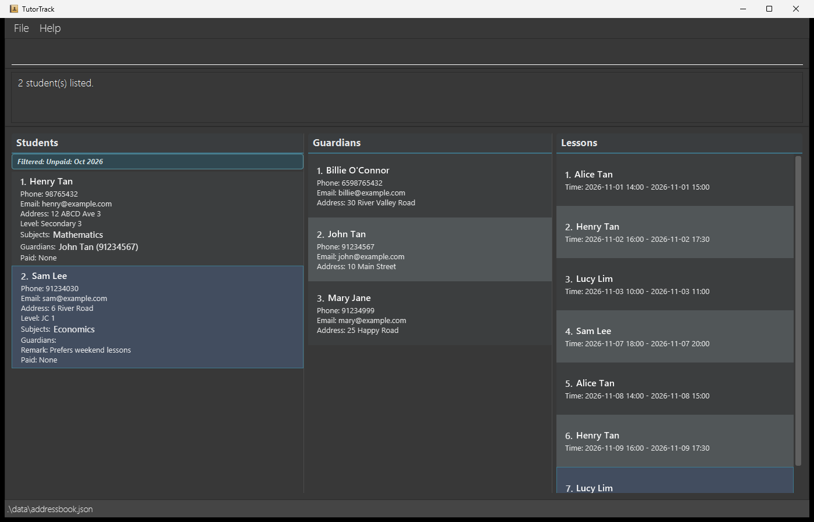

# TutorTrack User Guide

TutorTrack is a **desktop application for private tutors to manage students and guardians**, optimized for use through a Command Line Interface (CLI) while retaining the benefits of a Graphical User Interface (GUI). It helps tutors manage contact details, academic information, student payments, remarks, and student-guardian relationships efficiently.

<!-- * Table of Contents -->
<page-nav-print />

--------------------------------------------------------------------------------------------------------------------

## Quick start

1. Ensure that Java `25` or later is installed on your computer. 
   **Mac users:** Ensure you have the precise JDK version prescribed [here](https://se-education.org/guides/tutorials/javaInstallationMac.html).

1. Download the latest TutorTrack `.jar` file from the [TutorTrack releases page](https://github.com/AY2627S1-CS2103T-T15-3/tp/releases).

1. Copy the file to a writable folder that you want to use as TutorTrack's home folder. TutorTrack needs write access to this folder to save its data and preferences.

1. On some systems, double-clicking the JAR file may not launch TutorTrack. Open a terminal, `cd` to the folder containing the JAR file, and run `java -jar addressbook.jar`. 
   TutorTrack's graphical interface should appear in a few seconds. 
   

   The window has the following parts:
   * **Command box** (top): type commands here and press Enter.
   * **Result display** (below the command box): shows the outcome of each command, or an error message.
   * **Students panel** (left): each student card shows contact details, academic level, subjects, linked guardians,
     the remark (if any) and the months paid for.
   * **Guardians panel** (middle): each guardian card shows contact details.
   * **Lessons panel** (right): shows scheduled lessons. On launch, it shows today's lessons; use `view-l` to change
     which lessons are shown. The panel title shows the active lesson filter, e.g. `Lessons for 2026-11-01`.
   * **Status bar** (bottom): shows where the data file is saved.

   On the first launch, TutorTrack displays representative sample students, guardians,
   links, payments, remarks, and lessons. Run `clear` if you want to start with an
   empty address book before entering your own data.

1. Type a command in the command box and press Enter to execute it. For example, type **`help`** and press Enter to open the help window. 
   Some example commands you can try:

   * `list-s` : Lists all students.

   * `list-g` : Lists all guardians.

   * `add-s n/Henry Tan p/91234567 e/henry@example.com a/12 ABCD Ave 3 l/Secondary 3 s/Mathematics` : Adds a student.

   * `add-g n/Ben Tan p/92345678 e/ben.tan@gmail.com a/12 ABCD Ave 3` : Adds a guardian.

   * `edit-s 1 p/98765432` : Updates the phone number of the first student.

   * `edit-g 1 a/25 Happy Road` : Updates the address of the first guardian.

   * `link-g 1 g/1` : Links the first student to the first guardian.

   * `unlink-g 1 g/1` : Unlinks the first student from the first guardian.

   * `filter unpaid/2026-10` : Shows students who have not paid for October 2026.

   * `mark-paid 1 m/2026-10` : Marks the first displayed student as paid for October 2026.

   * `exit` : Exits the app.

1. Refer to the [Features](#features) section below for details of each command.

--------------------------------------------------------------------------------------------------------------------

## Features

<box type="info" seamless>

**Notes about the command format:** 

* Words in `UPPER_CASE` are the parameters to be supplied by the user. 
  For example, in `add-s n/NAME`, replace `NAME` with a value such as `John Doe`.

* Items in square brackets are optional. 
  For example, `filter [l/LEVEL]` can be used as `filter l/JC 1` or as part of a filter with other criteria.

* Items followed by `...` can appear zero or more times. 
  For example, the additional `[s/SUBJECT]...` parameters in `add-s` can be omitted or repeated, such as
  `s/Mathematics s/Physics`.

* Prefixed parameters can be in any order. 
  For example, `add-g n/NAME p/PHONE e/EMAIL a/ADDRESS` can be entered as
  `add-g p/PHONE n/NAME a/ADDRESS e/EMAIL`.

* Command words are case-insensitive. For example, `list-s`, `List-s`, `lIst-S`,
  and `LIST-S` are equivalent. Parameter prefixes such as `n/` and `d/` remain
  case-sensitive.

* For `set-remark-s` and `clear-remark-s`, the index must come first. In `set-remark-s`, everything after the index is remark text; no prefix is needed.

* Extraneous parameters for `help`, `exit`, and `clear` are ignored. 
  For example, `help 123` is interpreted as `help`. In contrast, `list-s`, `list-g` and `sort-s` reject any
  extra parameters.

* `INDEX`, `STUDENT_INDEX` and `GUARDIAN_INDEX` refer to the index number shown in the currently displayed list
  (which may be a filtered or searched list), and must be a positive integer such as 1, 2, 3, ...

* If you are using a PDF version of this document, be careful when copying and pasting commands that span multiple lines as space characters surrounding line-breaks may be omitted when copied over to the application.
</box>

### Accepted parameter values

Parameter | Constraints | Example
----------|-------------|--------
`NAME` | 1-100 characters. Letters, digits, spaces, periods, hyphens, apostrophes and slashes, with at least one letter or digit. | `Mary-Jane O'Connor`, `John s/o Raj`
`PHONE` | 3-15 digits, optionally starting with `+`. | `91234567`, `+6591234567`
`EMAIL` | `local-part@domain`, with no spaces and a domain such as `example.com`. | `henry@example.com`
`ADDRESS` | 1-200 characters. Letters, digits, spaces and the punctuation `, . # - / ( ) '`. | `12 ABCD Ave 3, #04-15`
`LEVEL` | 1-50 characters. Letters, digits, spaces and parentheses. | `Secondary 3 (Express)`
`SUBJECT` | 1-50 characters. Letters, digits, spaces, hyphens and parentheses. | `A-Level (H2)`
`REMARK` | Up to 300 characters, not blank, on a single line. | `Practise fractions`
`YYYY-MM` | A month of a year, with a two-digit month from `01` to `12`. | `2026-10`
`YYYY-MM-DD` | A valid calendar date. | `2026-11-01`
`HH:MM` | A valid 24-hour time. | `14:00`

Two students (or two guardians) are treated as the same person if they have the same name, ignoring
capitalization and extra spaces, and the same phone number.

### Viewing help: `help`

Opens a help window with a link to this user guide. Click `Copy URL` to copy the link. The help window can also be
opened from the `Help` menu or by pressing `F1`.

Format: `help`

### Adding a student: `add-s`

Adds a student with contact and academic details to TutorTrack.

Format: `add-s n/NAME p/PHONE e/EMAIL a/ADDRESS l/LEVEL s/SUBJECT [s/SUBJECT]...`

* All fields are required, and at least one `s/SUBJECT` must be provided.
* Additional `s/SUBJECT` parameters may be provided.
* The parameters can be entered in any order.
* A student with the same name (ignoring capitalization and extra spaces) and phone number cannot be added again.
* Adding a student preserves any active student filter or search. The new student is displayed only if it matches it.
* See [Accepted parameter values](#accepted-parameter-values) for the allowed format of each field.

Examples:
* `add-s n/Henry Tan p/91234567 e/henry@example.com a/12 ABCD Ave 3 l/Secondary 3 s/Mathematics s/Physics`
* `add-s n/Mary-Jane O'Connor p/+6591234567 e/mary@example.com a/12 ABCD Ave 3, #04-15 l/JC 1 s/A-Level (H2)`

### Adding a guardian: `add-g`

Adds a guardian's contact details to TutorTrack.

Format: `add-g n/NAME p/PHONE e/EMAIL a/ADDRESS`

* All fields are required and must be provided exactly once.
* The parameters can be entered in any order.
* Adding a guardian does not link them to a student; use `link-g` separately.
* A guardian with the same name (ignoring capitalization and extra spaces) and phone number cannot be added again.
* Adding a guardian preserves any active guardian search. The new guardian is displayed only if it matches the search.
* See [Accepted parameter values](#accepted-parameter-values) for the allowed format of each field.

Examples:
* `add-g n/Ben Tan p/92345678 e/ben.tan@gmail.com a/12 ABCD Ave 3`
* `add-g n/Billie O'Connor p/+6598765432 e/billie@example.com a/25 Happy Road`

### Scheduling lessons: `add-l`

Adds a weekly series of lessons for the student at the specified index in the
displayed student list. Each lesson has the same start time and duration, and
the dates are one week apart.

Format: `add-l INDEX d/YYYY-MM-DD t/HH:MM len/LENGTH(MINUTES) w/WEEKS`

The `d/`, `t/`, `len/`, and `w/` prefixes are required and may each be specified
only once. The `len/` prefix can be shortened to `l/`. `len/LENGTH(MINUTES)` (or
`l/LENGTH(MINUTES)`) and `w/WEEKS` must be positive integers. `w/WEEKS` must
not exceed 52. Dates and times must be valid, and a lesson cannot overlap an
existing lesson (of any student) or another lesson in the new series. If a
lesson is longer than 4 hours, the lessons are still added, but TutorTrack shows
a warning in case the length was entered by mistake.

Example:

`add-l 1 d/2026-11-01 t/14:00 len/60 w/4`

This schedules four one-hour lessons for the first displayed student, starting
at 2:00 PM on 1 November 2026. If a conflict is found, no lessons from the
series are added and the conflicting lesson is shown in the error message.

The active lesson filter is kept after adding lessons. For example, running
`view-l stu/4` followed by `add-l 4 d/2026-11-14 t/18:00 len/120 w/3` shows the
new lessons together with the student's existing lessons:

### Viewing lessons: `view-l`

Shows lessons for a selected date or student. The lesson list is sorted by date
and start time. When TutorTrack starts, the lessons panel shows today's lessons.

Formats:

* `view-l` — shows all lessons and clears the active lesson filter.
* `view-l d/YYYY-MM-DD` — shows lessons that take place on the specified date.
* `view-l stu/INDEX` — shows lessons for the student at the specified displayed
  student index.

The date must use the `YYYY-MM-DD` format. `d/` and `stu/` may not be used
together, and each may be specified only once. `INDEX` must be a positive
integer within the currently displayed student list. Extra arguments,
unknown parameters (e.g. `x/`), and invalid dates or indexes are rejected
without changing the lesson filter.

If lessons are filtered by student and that student is then edited with
`edit-s`, the filter follows the edited student, so their lessons remain shown.

A lesson is shown for every date it overlaps. For example, a lesson beginning
late on 1 November and ending after midnight on 2 November appears when either
date is selected.

The title of the lessons panel shows the active filter, such as `Lessons for 2026-11-01` or
`Lessons for Lucy Lim`, and changes back to `Lessons` when all lessons are shown.

Examples:

* `view-l d/2026-11-01`
* `view-l stu/1`
* `view-l`

### Removing a lesson: `remove-l`

Removes one lesson from TutorTrack using its displayed lesson index.

Format: `remove-l INDEX`

* `INDEX` must be a positive integer and must not exceed the number of lessons
  currently displayed.
* The index refers to the displayed lesson list, including a filtered list.
* Only the selected lesson is removed; other lessons in the same weekly series
  remain unchanged.

Example:

`remove-l 2`

This removes the second lesson in the currently displayed lesson list. If the
index is invalid, TutorTrack shows an error and no lesson is removed.

### Listing all students: `list-s`

Shows a list of all students in TutorTrack, clearing any active `filter` or `find-s` search.

Format: `list-s`

### Listing all guardians: `list-g`

Shows a list of all guardians in TutorTrack, clearing any active `find-g` search.

Format: `list-g`

### Editing a student: `edit-s`

Edits selected details of an existing student. The index refers to the displayed student list, including a filtered list.

Format: `edit-s INDEX [n/NAME] [p/PHONE] [e/EMAIL] [a/ADDRESS] [l/LEVEL] [s/SUBJECT]...`

* `INDEX` must be a positive integer within the displayed student list.
* At least one field must be provided. Fields that are not provided keep their current values.
* If `s/` is provided, it replaces the student's complete subject list. Retype existing subjects to keep them.
* A student must always have at least one subject.
* The edited student must not duplicate another student by name and phone number.
* The student's remark, payment history, guardian links and lessons are kept, and are shown with the updated details.

Examples:
* `edit-s 2 p/98765432 l/JC 2`
* `edit-s 1 s/Mathematics s/Physics`

### Setting a student remark: `set-remark-s`

Adds or updates a remark for a specified student.

Format: `set-remark-s INDEX REMARK`

* `INDEX` must be a positive integer within the currently displayed student list.
* `REMARK` must be nonblank, on a single line, and cannot exceed 300 characters.
* Each student has one remark; setting a new remark replaces the previous remark, if any.
* The remark is shown on the student's card as `Remark: ...`.

Examples:

Assuming Henry Tan, phone `91234567`, is student 1 in the displayed list:
* `set-remark-s 1 Practise fractions before the next lesson` displays the corresponding remark on Henry's information card.
* `set-remark-s 1 Bring the algebra worksheet on Friday` replaces Henry's previous remark with the new remark.

### Clearing a student remark: `clear-remark-s`

Removes a student's remark.

Format: `clear-remark-s INDEX`

* `INDEX` must be a positive integer within the currently displayed student list.
* Clearing a remark hides the remark field on the student's information card.
* If the student has no remark, TutorTrack shows an error.

Example:
* `clear-remark-s 1` clears the remark of the first displayed student, as well as hides the remark field on their information card

### Editing a guardian: `edit-g`

Edits selected details of an existing guardian. The index refers to the displayed guardian list, including a filtered list.

Format: `edit-g INDEX [n/NAME] [p/PHONE] [e/EMAIL] [a/ADDRESS]`

* `INDEX` must be a positive integer within the displayed guardian list.
* At least one field must be provided. Fields that are not provided keep their current values.
* The edited guardian must not duplicate another guardian by name and phone number.

Example:
* `edit-g 1 a/25 Happy Road e/ben.tan@example.com`

### Linking a guardian to a student: `link-g`

Links an existing guardian to an existing student.

Format: `link-g STUDENT_INDEX g/GUARDIAN_INDEX`

* Both indexes are required and must be positive integers within their respective displayed lists.
* The student and guardian must already exist.
* If the student and guardian are already linked, TutorTrack shows an error and no duplicate link is created.
* After a successful link, the student is highlighted and the guardian appears in the student card's `Guardians:` line.
* A student can be linked to multiple guardians, and a guardian can be linked to multiple students.
* Links are saved with TutorTrack and restored when the application is restarted.
* If a linked student or guardian is edited, the updated details are shown everywhere that record is linked.

Examples:
* `link-g 2 g/1`
* `link-g 3 g/1`

### Unlinking a guardian from a student: `unlink-g`

Unlinks an existing guardian from an existing student without deleting either
record.

Format: `unlink-g STUDENT_INDEX g/GUARDIAN_INDEX`

* Both indexes are required and must be positive integers within their respective displayed lists.
* The student and guardian must already exist and currently be linked.
* Removing a link does not remove either record or any of their other links.
* If the relationship does not exist, TutorTrack reports the selected student and guardian names.

Examples:
* `unlink-g 2 g/1`
* `unlink-g 3 g/1`

### Marking a student's payment as paid: `mark-paid`

Records that a student has paid for a given month of a year.

Format: `mark-paid INDEX m/YYYY-MM`

* Marks the student at the specified `INDEX` as paid for the month `YYYY-MM`. The index refers to the
index number shown in the currently displayed student list.
* The index **must be a positive integer** 1, 2, 3, ..., and must not exceed the number
of students in the displayed list.
* The month must be in the format `YYYY-MM`, with a two-digit month from `01` to `12`, e.g. `2026-10`.
* A student who is already marked as paid for that month is left unchanged, and an error is shown.
* Parameters other than `m/` are rejected with an `Unknown parameter` error.
* Each student's card shows the months they have paid for at the bottom of the card, most recent first, e.g. `Paid: Oct 2026, Sep 2026`. A student with no recorded payments shows `Paid: None`.
* Only the 3 most recent months are shown. If there are more, click the `+N more` button beside them to show all months, and click `Show less` to hide the older months again.

Examples:
* `mark-paid 1 m/2026-10` marks the 1st student in the displayed student list as paid for October 2026.
* `mark-paid 2 m/2026-11` marks the 2nd student in the displayed student list as paid for November 2026.

### Locating students by name: `find-s`

Finds students whose names contain any of the given keywords.

Format: `find-s KEYWORD [MORE_KEYWORDS]`

* The search is case-insensitive.
* Keyword order does not matter.
* The search considers only student names.
* Matches by prefix of each part of the name.
* Students matching at least one keyword are returned (an `OR` search).
* Matching parts of names are highlighted in the results.
* The active search is shown above the student list, e.g. `Search: alice lucy`, and remains visible while other
  commands are executed. It is cleared by `list-s` or replaced by a new `find-s` or `filter` command.

Examples:
* `find-s alex david` returns matching students named Alex or David.
* `find-s alice lucy` returns `Alice Tan` and `Lucy Lim` from the sample data:

  

### Locating guardians by name: `find-g`

Finds guardians whose names contain any of the given keywords.

Format: `find-g KEYWORD [MORE_KEYWORDS]`

* The search is case-insensitive.
* Keyword order does not matter.
* The search considers only guardian names.
* Matches by prefix of each part of the name.
* Guardians matching at least one keyword are returned (an `OR` search).
* Matching parts of names are highlighted in the results.
* The active search is shown above the guardian list, e.g. `Search: tan`, and remains visible while other commands
  are executed. It is cleared by `list-g` or replaced by a new `find-g` command.

Examples:
* `find-g alex david` returns matching guardians named Alex or David.
* `find-g tan` returns `John Tan` from the sample data:

  

### Filtering students: `filter`

Shows only the students who match all of the given criteria. The guardian list is not changed.

Format: `filter [l/LEVEL] [s/SUBJECT]... [paid/YYYY-MM] [unpaid/YYYY-MM]`

* At least one criterion must be provided.
* Academic levels may contain alphanumeric characters, spaces and parentheses, e.g. `Secondary 3 (Express)`.
* `l/LEVEL` shows students at that academic level. The match ignores case and extra spaces, e.g. `jc 1` matches `JC 1`.
* `s/SUBJECT` shows students who take that subject. If several subjects are given, a student must take **all** of them.
* `paid/YYYY-MM` shows students who have been marked as paid for that month using `mark-paid`.
* `unpaid/YYYY-MM` shows students who have **not** been marked as paid for that month.
* `l/`, `paid/` and `unpaid/` can each be given at most once.
* Any other parameter, such as `n/` or a misspelt `unpiad/`, is rejected with an `Unknown parameter` error, and the
  displayed list is not changed.
* Student indexes in later commands, such as `mark-paid` or `edit-s`, refer to the filtered list.
* The active filter is shown above the student list, e.g. `Filtered: Unpaid: Oct 2026`, and remains visible while
  other commands, such as `sort-s`, are executed. It is cleared by `list-s` or replaced by a new `filter` or `find-s`
  command.

Examples:
* `filter l/JC 1 s/Mathematics` shows JC 1 students who take Mathematics.
* `filter unpaid/2026-10` shows students who have not paid for October 2026.
* `filter l/Secondary 3 paid/2026-09 unpaid/2026-10` shows Secondary 3 students who paid for September 2026 but not for October 2026.

### Sorting students: `sort-s`

Sorts the displayed student list by name in ascending order. Any active filter or search is kept.

Format: `sort-s`

### Removing a student: `remove-s`

Removes a specified student from TutorTrack.

Format: `remove-s INDEX`

* Removes the student at the specified `INDEX`. The index refers to the
index number shown in the currently displayed student list.
* The index **must be a positive integer** 1, 2, 3, ..., and must not exceed the number
of students in the displayed list.
* Removing a student also removes the student's lessons and all associated student-guardian links, but the
associated guardian records are not deleted.

Examples:
* `remove-s 2` removes the 2nd student in the currently displayed student list.
* `remove-s 1` removes the 1st student in the currently displayed student list, even if it is filtered.

### Removing a guardian: `remove-g`

Removes a specified guardian from TutorTrack.

Format: `remove-g INDEX`

* Removes the guardian at the specified `INDEX`. The index refers to the
index number shown in the currently displayed guardian list.
* The index **must be a positive integer** 1, 2, 3, ..., and must not exceed the number
  of guardians in the displayed list.
* Removing a guardian also removes all associated student-guardian links, but the associated
  student record is not deleted.

Examples:
* `remove-g 2` removes the 2nd guardian in the currently displayed guardian list.
* `remove-g 1` removes the 1st guardian in the currently displayed guardian list, even if it is filtered

### Clearing all entries: `clear`

Clears all students, guardians, lessons, and student-guardian links from TutorTrack, including the sample data.

Format: `clear`

### Exiting the program: `exit`

Exits the program.

Format: `exit`

### Saving the data

TutorTrack automatically saves data after every command. You do not need to save manually.

### Editing the data file

TutorTrack data is saved automatically as a JSON file at
`[JAR file location]/data/addressbook.json`.

<box type="warning" seamless>

**Caution:**
If the data file is invalid, TutorTrack **deletes it** and starts with an empty data set at the next run. Back up the file before making any manual changes. 
If the data file is missing, TutorTrack starts with the sample data instead.
</box>

--------------------------------------------------------------------------------------------------------------------

## FAQ

**Q**: How do I transfer my data to another computer? 
**A**: Install TutorTrack on the other computer and replace its data file with the data file from your previous TutorTrack home folder.

--------------------------------------------------------------------------------------------------------------------

## Known issues

1. **When using multiple screens**, if you move the application to a secondary screen, and later switch to using only the primary screen, the GUI will open off-screen. The remedy is to delete the `preferences.json` file created by the application before running the application again.
2. **If you minimize the Help Window** and then run the `help` command (or use the `Help` menu, or the keyboard shortcut `F1`) again, the original Help Window will remain minimized, and no new Help Window will appear. The remedy is to manually restore the minimized Help Window.
3. **On macOS**, using fullscreen mode for secondary dialogs such as the Help dialog may cause unexpected behaviour.

--------------------------------------------------------------------------------------------------------------------

## Command summary

Action     | Format, Examples
-----------|----------------------------------------------------------------------------------------------------------------------------------------------------------------------
**Add student** | `add-s n/NAME p/PHONE e/EMAIL a/ADDRESS l/LEVEL s/SUBJECT [s/SUBJECT]...`   e.g., `add-s n/Henry Tan p/91234567 e/henry@example.com a/12 ABCD Ave 3 l/Secondary 3 s/Mathematics s/Physics`
**Add guardian** | `add-g n/NAME p/PHONE e/EMAIL a/ADDRESS`   e.g., `add-g n/Ben Tan p/92345678 e/ben.tan@gmail.com a/12 ABCD Ave 3`
**Schedule lessons** | `add-l INDEX d/YYYY-MM-DD t/HH:MM len/LENGTH(MINUTES) w/WEEKS`   e.g., `add-l 1 d/2026-11-01 t/14:00 len/60 w/4`
**Remove lesson** | `remove-l INDEX`  e.g., `remove-l 2`
**View lessons** | `view-l [d/YYYY-MM-DD | stu/INDEX]`  e.g., `view-l d/2026-11-01`
**Set student remark** | `set-remark-s INDEX REMARK`  e.g., `set-remark-s 1 Practise fractions before the next lesson`
**Clear student remark** | `clear-remark-s INDEX`  e.g., `clear-remark-s 1`
**Clear**  | `clear`
**Edit student** | `edit-s INDEX [n/NAME] [p/PHONE] [e/EMAIL] [a/ADDRESS] [l/LEVEL] [s/SUBJECT]...`  e.g., `edit-s 2 p/98765432 l/JC 2`
**Edit guardian** | `edit-g INDEX [n/NAME] [p/PHONE] [e/EMAIL] [a/ADDRESS]`  e.g., `edit-g 1 a/25 Happy Road`
**Filter** | `filter [l/LEVEL] [s/SUBJECT]... [paid/YYYY-MM] [unpaid/YYYY-MM]`  e.g., `filter l/JC 1 unpaid/2026-10`
**Find student** | `find-s KEYWORD [MORE_KEYWORDS]`  e.g., `find-s James Jake`
**Find guardian** | `find-g KEYWORD [MORE_KEYWORDS]`  e.g., `find-g James Jake`
**Link guardian** | `link-g STUDENT_INDEX g/GUARDIAN_INDEX`  e.g., `link-g 2 g/1`
**Unlink guardian** | `unlink-g STUDENT_INDEX g/GUARDIAN_INDEX`  e.g., `unlink-g 2 g/1`
**List students** | `list-s`
**List guardians** | `list-g`
**Mark paid** | `mark-paid INDEX m/YYYY-MM`  e.g., `mark-paid 1 m/2026-10`
**Remove student** | `remove-s INDEX`  e.g., `remove-s 2`
**Remove guardian** | `remove-g INDEX`  e.g., `remove-g 1`
**Sort students** | `sort-s`
**Exit** | `exit`
**Help**   | `help`
